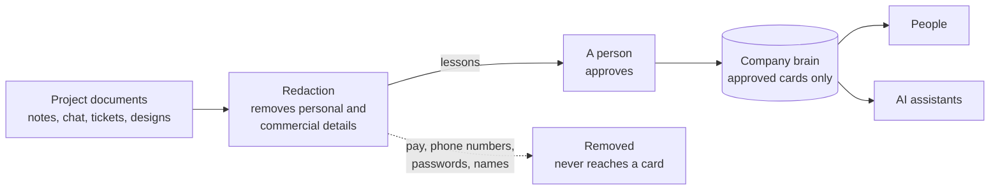
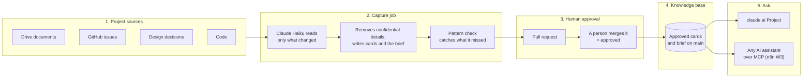

# Company Brain POC

A company brain captures each team's learnings and shares them with the rest of the company, after a person approves it. People and AI assistants can then ask it questions.

For example, a team's meeting notes record that a test run of a new billing system found errors before go-live. This lesson becomes a short learning card that any AI assistant can quote. Sensitive information such as a colleague's pay, mentioned in the same folder, never reaches a card.

I tested my company brain on project documents it had never seen. It identified and removed all 6 fake confidential details, leaked no names and passed 7 of 7 judgement tests marked by a person. For more information, see [Results](#results).

## Overview

Project knowledge is spread across meeting notes, chat, tickets and design documents. Nobody reads all of it, and nobody wants the personal or commercial details in it spread around the company.

This proof of concept (POC) reads one project's documents and writes two things:

- **A project brief:** one page with the current status, decisions, risks, points where documents disagree, and facts that later documents replaced. Every fact links to its source.
- **Learning cards:** short lessons another team can reuse, such as asking the customer for access to their test system at the start of a project.

> [!NOTE]
> Nothing reaches the shared knowledge base until a person approves it. Personal data, passwords and commercial terms are removed first. People and AI assistants can read only approved content.

The company brain has two modes of operation:

1. A Claude Code job that you run on demand.
2. Automated n8n workflows (see [Operated with n8n](#operated-with-n8n)).

Built by Abhishek Katta with Claude Code and n8n. Portfolio: [abhishekkatta.netlify.app](https://abhishekkatta.netlify.app).

## Use cases

- **Retrieve sanitised knowledge:** Give AI assistants project knowledge they can quote, without exposing personal or commercial data.
- **Reuse lessons across projects:** A card written by one team answers the next team's question.
- **Self-serve onboarding:** A new team member can query the knowledge base to get up to speed, saving productive hours for the team.
- **Transparent conflict-flagging:** Show where documents disagree, instead of letting an AI assistant quietly pick one side.

## Why I built this

- **One GenAI setup:** To see how one Claude setup could serve both a project team and the whole company: shared context for the team, and a knowledge base anyone can ask questions.
- **Summarise once, read many:** Reading documents for every question is slow and expensive. I designed the brain to read only what changed since the last refresh, use a small, cheap AI model to pull out the facts, and answer from the brief before opening the original documents.
- **Eval set for trust:** I built evidence by hiding the failures a real company fears most in the test documents such as leaked personal data, disagreements settled without anyone noticing, and made-up facts, and scored every run.

## How it works

The capture job opens a pull request (PR) on GitHub to propose a change for review. A person merges it to accept the change.

Show which stand-in replaces each company system

| In a real company | In this POC |
|---|---|
| Project file share | A Google Drive folder (copies in [`sources/`](sources/)) |
| Team chat | A Drive document holding a chat log |
| Issue tracker | GitHub Issues on this repo |
| Team code and design records | This repo: [`src/`](src/), [`docs/`](docs/), [`decisions/`](decisions/) |
| Company knowledge base | [`learnings/approved/`](learnings/approved/) |
| Company search | A claude.ai Project (a Claude workspace limited to chosen files) that knows only the approved cards, or any AI assistant connected through the n8n workflow W3 |

## Key design choices

- **Rules in files, not prompts.** [`CLAUDE.md`](CLAUDE.md) has the card format, the 7 redaction rules (what to remove) and the rule for disagreements. See capture steps in [`.claude/agents/card-extractor.md`](.claude/agents/card-extractor.md).
- **Small model, narrow job.** Claude Haiku, a small and cheap model, pulls out the facts. It reads only what changed since the last run. [`log.md`](log.md) records where the last run stopped.
- **Show disagreements, do not resolve them.** When two documents disagree and neither replaces the other, the brief lists both under "Open conflicts". When a later document clearly states a change, the brief records the new fact and marks the old one as replaced.
- **Approval is a merge.** Capture opens a pull request. The `main` branch, the approved version, never holds an unapproved card.

## Operated with n8n

n8n is a workflow automation tool. The same capture and question-answering steps also run as four n8n workflows, with no Claude Code session. The workflow exports and an import guide are in [`n8n/`](n8n/).

- **W1 Capture:** when a new Google Doc appears in the project folder, n8n sends it to Claude Haiku with the redaction rules, then runs the same pattern check as [`scripts/redaction_check.py`](scripts/redaction_check.py). A clean card opens a pull request. If the lesson cannot be written without confidential details, the document is held and gets no card.
- **W2 Error alerts:** if W1, W3 or W3a fails during a real run, n8n emails me the failed step, the error and a link to the run.
- **W3 Ask the brain:** an MCP server, protected by a secret access key (a Bearer token). MCP, the Model Context Protocol, is the standard way AI assistants connect to outside tools. W3 offers two tools: `search_approved_cards` and `get_brief`. Both read only the approved version on `main`, so an assistant sees a card only after a person merges it.
- **W3a Card search:** the keyword search behind `search_approved_cards`. It returns up to 3 cards with their IDs, or "No approved learning covers this."

W1 writes cards only. The Claude Code job still rebuilds the brief.

### Prototype vs at scale

The approval step stays the same at any size: an AI assistant reads only what a person approved. What changes is how documents come in, how confidential details are caught and how cards are found.

Show all 10 parts and how each one changes at scale

| Step | In this prototype | At scale |
|---|---|---|
| Sources | n8n checks one Drive folder every minute. It picks up new documents only, not edits. | Drive, SharePoint and Slack notify the system as soon as something changes. An edited document is captured again. |
| Redaction | Rules in the instructions to Claude, then a pattern check. Claude sees the original text. | A dedicated tool for finding personal and sensitive data (such as Google Sensitive Data Protection, Microsoft Purview or Presidio) removes it before Claude sees the text. The rules and the pattern check stay as extra layers. The AI provider agrees not to store the data. |
| Extraction | One card per document, from the first 60,000 characters. | Long documents are split into parts, with several cards per document, and every card is checked against a fixed format. A new card is compared with existing cards to avoid duplicates. The test set runs again whenever the instructions change. |
| Held documents | The workflow stops, and nobody is told. | A review list records why the document was held and tells its owner. |
| Approval | One person merges a pull request on GitHub. | The same merge, with a named owner for each topic. Reviewers who do not use GitHub approve in Slack or email, through n8n's built-in approval step. |
| Search | Simple keyword matching. Each question reads every card from GitHub. | Cards are indexed when they are approved, so search can match meaning as well as keywords ("leave" also finds "absence"). Answers still cite card IDs. |
| Freshness | Cards never expire. The check for out-of-date claims (`/lint-wiki`) runs only when someone starts it. | Each card has an owner and a review date. The check runs on a schedule, and a newer card retires the one it replaces. |
| Access | One shared access key. Everyone with the key sees every approved card. | Each person signs in and sees only the cards their role allows, using each card's `sensitivity` field. |
| Operations | An email when a workflow fails. One n8n trial account. | Automatic retries, alerts in Slack or to the on-call person, extra capacity for busy periods, separate test and live setups, and keys kept in a secure vault. |
| Coverage and audit | Questions are stored only in n8n's run history. Nobody reviews them. | Every question is logged with who asked and which cards answered. Each "No approved learning covers this" is counted, which shows what the brain is missing. |

For more information on what this prototype does not prove, see [Known gaps](#known-gaps).

## How I tested it

> [!NOTE]
> All project data in this repo is fictional. The names, contact details, passwords and commercial terms are planted for the redaction test.

The test project is "Project Alpha": a utility company moving its smart-meter readings to a new real-time billing system. Its documents hide things the job must handle:

- **Redaction:** 20 fake confidential details (phone number, home address, health, pay, performance, date of birth, passwords, access tokens, customer account, contract value, profit margin, talk of switching suppliers, an invoice dispute) and 11 people's names.
- **Judgement:** 3 places where documents disagree, 1 fact that a later document replaced, and 8 lessons a careful reader should find.
- **Answer key:** [`tests/answers/`](tests/answers/). The capture job is told never to read `tests/`.
- **Unseen test set:** 2 more Drive documents and 1 issue with new kinds of hidden details, an answer key written before any run saw them, and one trap (the same date written two ways).

[`tests/score.py`](tests/score.py) checks redaction and names automatically, and lists the judgement tests for a person to mark. Each round's marks and scores are saved in [`tests/results/`](tests/results/).

## Results

| Round | Change | Redaction | Names leaked | Judgement tests |
|---|---|---|---|---|
| 1 | First version | 20/20 | 0 | 8/12 |
| 2 | New rules for disagreements and lessons | 20/20 | 0 | 11/12 |
| 3 | Clearer wording for disagreements, after reviewer feedback | 20/20 | 0 | 11/12, less clutter |
| 4 | **Unseen documents, rules locked** | **6/6** | **0** | **7/7** |

Each round has a page in [`iterations/`](iterations/) with what failed, the exact rule change, the score after and the cost. Round 3 is the clearest example: a reviewer said the list of disagreements was unclear, and the page shows the list before and after the rule change.

## Known gaps

- **One disagreement in the main test set is still missed (C1).** C1 is not in the unseen set, which is why round 4 shows 7/7. A meeting note says "Agreed: retention is 30 days"; the design document says 90. The rule reads "agreed" as a change, so the brief treats 30 days as the new fact instead of flagging the disagreement.
- **Made-up facts are not scored.** Round 1 made up 4 facts. One got past human review, and the question-answering Project then repeated it with confidence. A spot check of the current output found no unsourced numbers or reasons, but no script tests for this yet.
- **Redaction protects the knowledge base, not the original documents.** A Project that read the Drive documents directly answered one question with a team member's leave dates. Access to the original documents needs its own controls.

Show 6 more gaps

- **The one-page brief loses history.** The 600-word limit pushed older, replaced dates out of the brief in round 4. The cards still hold them.
- **Rounds 2 and 3 were tuned on the same test they were scored on.** Round 4 is the only unseen test, and the same person wrote its documents and the rules.
- **A person, not a script, marks the judgement tests.**
- **Cost doubled** from round 1 to round 2 as the rules grew: from about 59,000 to 115,000 Haiku tokens for a full rebuild, and 93,000 for a small update. Tokens are the units AI models charge by.
- **The cost test has not been run.** [`tests/eval_questions.md`](tests/eval_questions.md) compares answering from the brief with answering from the original documents.
- **One-person simulation.** No real user roles, single sign-on, permission-aware search, Microsoft 365 or ticketing system. The stand-ins show the shape, not the scale.

## Repo map

Show what each file and folder holds

| Path | What it is |
|---|---|
| [`CLAUDE.md`](CLAUDE.md) | The rules: card format, what to remove and how to handle disagreements |
| [`brief.md`](brief.md) | The current project brief |
| [`learnings/approved/`](learnings/approved/) | Approved learning cards |
| [`sources/`](sources/) | Copies of the Drive documents (fictional, with planted details) |
| [`src/`](src/), [`docs/`](docs/), [`decisions/`](decisions/) | The stand-in team repo: code, architecture notes and architecture decision records (ADRs) |
| [`iterations/`](iterations/) | One page per improvement round |
| [`tests/`](tests/) | Answer keys, the scoring script and saved results |
| [`scripts/redaction_check.py`](scripts/redaction_check.py) | The pattern check that backs up the redaction step |
| [`.claude/`](.claude/) | The Claude Code commands for capture and checking, and the small-model helpers they use |
| [`project-instructions/`](project-instructions/) | Instructions for the two claude.ai Projects |
| [`log.md`](log.md) | A log of every run: counts, cost and where the last run stopped |
| [`n8n/`](n8n/) | Exports of the four n8n workflows, with an import guide |
| [`CONTRIBUTING.md`](CONTRIBUTING.md) | How to run, review and extend the POC |
| [`poc-config.json`](poc-config.json) | The Drive folder ID, and which Drive document matches which file in `sources/` |

## Run it

You need Claude Code, the GitHub CLI, Python 3 and the Google Drive connector, plus your own Drive folder. Set its ID in [`poc-config.json`](poc-config.json).

> [!WARNING]
> Capture sends document text to the Anthropic API before redaction. Use test data only.

Show the steps to run capture with Claude Code

1. Run `/capture` in Claude Code in this folder. It opens a pull request with new cards and a fresh brief.
2. Review the pull request. Merge it to approve, or close it to reject.
3. Run `python tests/score.py`, then mark the judgement tests it prints. Add `--save <run>` to keep the record.
4. Run `/lint-wiki`. It writes [`lint-report.md`](lint-report.md): disagreements, out-of-date claims, cards nothing links to, and duplicates.
5. Optional: create the claude.ai Projects "Alpha" and "Ask the Org" from [`project-instructions/`](project-instructions/) to ask questions over the brief and the cards.

To run capture and questions on n8n instead, import the workflows in [`n8n/`](n8n/). For more information, see [`n8n/README.md`](n8n/README.md).
