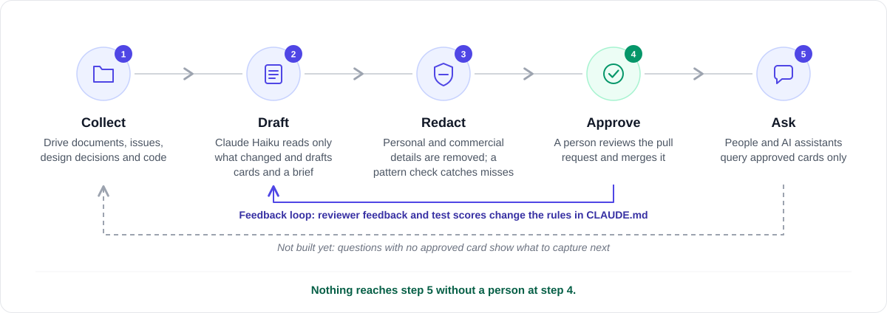
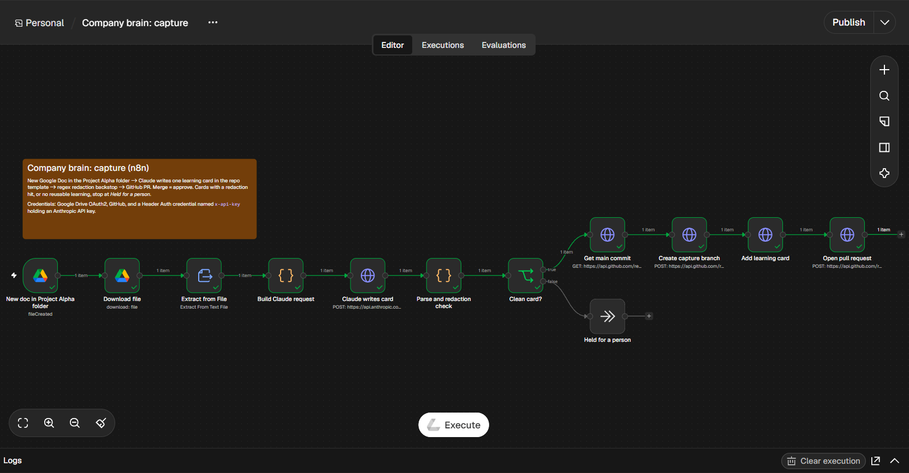

# Company Brain POC

Designed, built, and tested by **[Abhishek Katta](https://abhishekkatta.netlify.app)** with Claude Code and n8n.

A company brain captures each team's learnings and shares them with the rest of the company, after a person approves them. People and AI assistants can then ask it questions.

*Figure 1. Only content that a person approves reaches people and AI assistants. Redaction removes confidential details before a person reviews the cards.*

For example, a team's meeting notes record that a test run of a new billing system found errors before go-live. That lesson becomes a short learning card that any AI assistant can quote. A colleague's pay, mentioned in the same folder, never reaches a card.

**Tested on project documents it had never seen, with its rules locked:**

| 6 of 6 | 0 | 7 of 7 |
|:---:|:---:|:---:|
| Fabricated confidential details removed | Names leaked | Judgement tests passed, marked by a person |

For more information, see [Results](#results).

## Overview

Project knowledge sits in meeting notes, chat, tickets, and design documents. Nobody reads all of it, and nobody wants the personal or commercial details in it spread around the company.

This proof of concept (POC) reads one project's documents and writes two things:

- **A project brief:** One page with the current status, decisions, risks, conflicts between documents, and facts that later documents replaced. Each fact links to its source.
- **Learning cards:** Short lessons another team can reuse. For example, ask the customer for access to their test system during project kickoff.

It runs in two modes:

1. A Claude Code job (`/capture`) that proposes new cards and a fresh brief. In this POC, I start it by hand. At scale, it runs on a schedule.
2. Four automated n8n workflows (see [Operated with n8n](#operated-with-n8n)).

## Use cases

*Figure 2. Four ways that people and AI assistants use the company brain.*

## Why I built this

- **One GenAI setup:** To see how one Claude setup could serve both a project team and the whole company: shared context for the team, and a knowledge base anyone can ask questions.
- **Summarise once, read many:** Reading every document for every question is slow and expensive. The brain reads only what changed, uses a small, cheap model to pull out the facts, and answers from the brief first.
- **Eval set for trust:** I built evidence by hiding the failures a real company fears most in the test documents, such as leaked personal data, made-up facts, and conflicts settled without anyone noticing. I then scored each iteration.

## How it works

*Figure 3. The five steps of the capture job. Nothing reaches step 5 without a person at step 4.*

The capture job opens a pull request (PR) on GitHub to propose new cards and a fresh brief. A person approves them by merging the PR. The prototype uses simple stand-ins for company systems, such as a Google Drive folder for the project file share. For every stand-in, see [Prototype vs at scale](#prototype-vs-at-scale).

### Key design choices

| Choice | How it works | Where to look |
|---|---|---|
| **Rules in files instead of prompts** | Files hold the card format, the 7 redaction rules (what to remove), the conflict rule, and the capture steps. | [`CLAUDE.md`](CLAUDE.md), [`card-extractor.md`](.claude/agents/card-extractor.md) |
| **Small model, narrow job** | Claude Haiku, a small and cheap model, pulls out the facts. It reads only what changed since the last run. A small update costs about 20% less than a full rebuild (93,000 against 115,000 tokens). | [`log.md`](log.md) records where the last run stopped |
| **Two layers of redaction** | Claude follows the redaction rules, then a pattern check catches what it missed. | [`redaction_check.py`](scripts/redaction_check.py) |
| **Show conflicts, do not resolve them** | When two documents disagree and neither replaces the other, the brief lists both under "Open conflicts". When a later document clearly states a change, the brief records the new fact and marks the old one as replaced. | [`brief.md`](brief.md) |
| **Approval is a merge** | The `main` branch, the approved version, never holds an unapproved card. | [`learnings/approved/`](learnings/approved/) |

## Operated with n8n

n8n is a workflow automation tool. The same capture and question-answering steps also run as four n8n workflows, with no Claude Code session. See [`n8n/`](n8n/) for the workflow exports and an import guide.

![Four n8n workflows. W1 Capture checks the Drive folder every minute. Claude Haiku writes one card, a redaction check tests it, and a clean card opens a pull request; otherwise W1 holds the document and writes no card. A person merges the pull request into the main branch. W3 Ask the brain is an MCP server with a Bearer token: search_approved_cards runs W3a Card search, and get_brief returns brief.md, both from the main branch only. W2 Error alerts emails the failed step, the error, and a link to the run if W1, W3, or W3a fails.](assets/n8n-workflows.svg)

*Figure 4. The four n8n workflows. W1 opens pull requests, W3 and W3a read only the `main` branch, and W2 sends an email when a workflow fails.*

Show what each workflow does

- **W1 Capture:** When a new Google Doc appears in the project folder, n8n sends it to Claude Haiku with the redaction rules, then runs the same pattern check. A clean card opens a pull request. If Claude cannot write the lesson without confidential details, W1 holds the document and writes no card.
- **W2 Error alerts:** If W1, W3, or W3a fails during a real run, n8n emails the failed step, the error, and a link to the failed run.
- **W3 Ask the brain:** An MCP server with two tools, `search_approved_cards` and `get_brief`, protected by a secret access key (a Bearer token). Both tools read only the `main` branch, so an assistant sees only approved cards.
- **W3a Card search:** The keyword search behind `search_approved_cards`. It returns up to 3 cards with their IDs, or "No approved learning covers this."

> [!NOTE]
> - MCP (Model Context Protocol) is the standard way AI assistants connect to outside tools.
> - W1 only writes cards. The Claude Code job still rebuilds the brief.

### What I tested in n8n

*Figure 5. The three live tests in n8n and their results.*

The four capture fixes run from a blocked Drive credential to a reply-parsing bug. See [Live fixes](n8n/README.md#live-fixes).

Show the W1 capture workflow in n8n

*Figure 6. W1 in the n8n editor, from the Drive trigger to the pull request or the held document.*

## Prototype vs at scale

The approval step stays the same at any scale: an AI assistant reads only what a person approved. What changes is how documents come in, how the system catches confidential details, and how people find cards. The table also lists the stand-in that the prototype uses for each company system.

Show all 10 parts and how each one changes at scale

| Step | In this prototype | At scale |
|---|---|---|
| Sources | Stand-ins: a Google Drive folder for the project file share (copies in [`sources/`](sources/)), a Drive document holding a chat log for team chat, GitHub Issues on this repo for the issue tracker, and this repo ([`src/`](src/), [`docs/`](docs/), [`decisions/`](decisions/)) for team code and design records. n8n checks the Drive folder every minute. It picks up new documents only, not edits. | Drive, SharePoint, and Slack notify the system as soon as something changes. The system captures an edited document again. |
| Redaction | Rules in the instructions to Claude, then a pattern check. Claude sees the original text. | A dedicated tool for finding personal and sensitive data (such as Google Sensitive Data Protection, Microsoft Purview, or Presidio) removes it before Claude sees the text. The rules and the pattern check stay as extra layers. The AI provider agrees not to store the data. |
| Extraction | One card per document, from the first 60,000 characters. | The system splits long documents into parts, writes several cards per document, and checks every card against a fixed format. It compares each new card with existing cards to avoid duplicates. The test set runs again whenever the instructions change. |
| Held documents | The workflow stops and tells nobody. | A review list records why W1 held the document and tells its owner. |
| Approval | One person merges a pull request on GitHub. | The same merge, with a named owner for each topic. Reviewers who do not use GitHub approve in Slack or email, through n8n's built-in approval step. |
| Search | Stand-ins: [`learnings/approved/`](learnings/approved/) for the company knowledge base. For company search, a claude.ai Project (a Claude workspace limited to chosen files) that knows only the approved cards, or any AI assistant connected through W3. Simple keyword matching. Each question reads every card from GitHub. | The system indexes cards when a person approves them, so search can match meaning as well as keywords ("leave" also finds "absence"). Answers still cite card IDs. |
| Freshness | Cards never expire. The check for out-of-date claims (`/lint-wiki`) runs only when someone starts it. | Each card has an owner and a review date. The check runs on a schedule, and a newer card retires the one it replaces. |
| Access | One shared access key. Everyone with the key sees every approved card. | Each person signs in and sees only the cards their role allows, using each card's `sensitivity` field. |
| Operations | An email when a workflow fails. One n8n trial account. | Automatic retries, alerts in Slack or to the on-call person, extra capacity for busy periods, separate test and live setups, and keys in a secure vault. |
| Coverage and audit | Only n8n's run history stores questions. Nobody reviews them. | The system logs every question with who asked and which cards answered. It counts each "No approved learning covers this", which shows what the brain is missing. |

For what this prototype does not prove, see [Known gaps](#known-gaps).

## How I tested it

I planted the failures a company fears most in a fictional project, then scored each round against an answer key.

Show the test project and how it is scored

> [!NOTE]
> All project data in this repo is fictional. I fabricated the names, contact details, passwords, and commercial terms.

"Project Alpha" is the test project: a utility company moving its smart-meter readings to a new real-time billing system. Its documents contain what the capture job must handle:

- **Redaction:** 11 people's names, and 20 fabricated confidential details (phone number, home address, health, pay, performance, date of birth, passwords, access tokens, customer account, contract value, profit margin, talk of switching suppliers, and an invoice dispute).
- **Judgement:** 3 conflicts between documents, 1 fact that a later document replaced, and 8 lessons a careful reader would find.
- **Answer key:** [`tests/answers/`](tests/answers/). The rules tell the capture job never to read `tests/`.
- **Unseen test set:** 2 more Drive documents and 1 issue with new kinds of hidden details, an answer key that I wrote before any run saw them, and one trap (the same date written two ways).

[`tests/score.py`](tests/score.py) checks redaction and names automatically, and lists the judgement tests for a person to mark. [`tests/results/`](tests/results/) holds each round's marks and scores.

## Results

Redaction held in all 4 rounds with 0 names leaked. Judgement tests rose from 8/12 to 11/12, then passed 7/7 on unseen documents.

Show the scores for each round

| Round | Change | Redaction | Names leaked | Judgement tests |
|---|---|---|---|---|
| 1 | First version | 20/20 | 0 | 8/12 |
| 2 | New rules for conflicts and lessons | 20/20 | 0 | 11/12 |
| 3 | Clearer wording for conflicts, after reviewer feedback | 20/20 | 0 | 11/12, less clutter |
| 4 | **Unseen documents (a held-out set), rules locked** | **6/6** | **0** | **7/7** |

Each round has a page in [`iterations/`](iterations/) with its failures, the exact rule change, the score after, and the cost. Round 3 is the clearest example: a reviewer said the list of conflicts was unclear, and the page shows the list before and after the rule change.

## Known gaps

The biggest gap: the brief still misses one conflict in the main test set.

Show all 9 gaps

- **One missed conflict (C1).** A meeting note says "Agreed: retention is 30 days"; the design document says 90. The rule reads "agreed" as a change, so the brief records 30 days as the new fact. C1 is not in the unseen set, so round 4 shows 7/7.
- **No test for made-up facts.** Round 1 made up 4 facts. A human review missed one, and a Claude Project then repeated it with confidence. A spot check of the current output found no unsourced numbers or reasons, but no script tests for this.
- **Redaction covers the knowledge base, not the original documents.** A Project that read the Drive documents directly gave out a team member's leave dates. The original documents need their own access controls.
- **The brief loses history.** In round 4, the 600-word limit pushed older, replaced dates out of the brief. The cards still hold them.
- **Same test for tuning and scoring.** I tuned rounds 2 and 3 on the test I scored them on. Round 4 is the only unseen test, and I wrote both its documents and the rules.
- **A person, not a script, marks the judgement tests.**
- **Cost doubled as the rules grew.** A full rebuild went from about 59,000 Haiku tokens in round 1 to 115,000 in round 2. A small update takes 93,000.
- **The cost test has not run.** [`tests/eval_questions.md`](tests/eval_questions.md) compares answering from the brief with answering from the original documents.
- **One-person simulation.** No real user roles, single sign-on, permission-aware search, Microsoft 365, or ticketing system. The stand-ins show the shape of the solution, not how it behaves at scale.

## Repo map

Show what each file and folder holds

| Path | Description |
|---|---|
| [`CLAUDE.md`](CLAUDE.md) | The rules: card format, what to remove, and how to handle conflicts |
| [`brief.md`](brief.md) | The current project brief |
| [`learnings/approved/`](learnings/approved/) | Approved learning cards |
| [`sources/`](sources/) | Copies of the Drive documents (fictional, with planted details) |
| [`src/`](src/), [`docs/`](docs/), [`decisions/`](decisions/) | The stand-in team repo: code, architecture notes, and architecture decision records (ADRs) |
| [`iterations/`](iterations/) | One page per improvement round |
| [`tests/`](tests/) | Answer keys, the scoring script, and saved results |
| [`scripts/redaction_check.py`](scripts/redaction_check.py) | The pattern check that backs up the redaction step |
| [`.claude/`](.claude/) | The Claude Code commands for capture and checking, and the small-model helpers they use |
| [`project-instructions/`](project-instructions/) | Instructions for the two claude.ai Projects |
| [`log.md`](log.md) | A log of every run: counts, cost, and where the last run stopped |
| [`n8n/`](n8n/) | Exports of the four n8n workflows, with an import guide |
| [`assets/`](assets/) | The diagrams and the n8n screenshot in this README |
| [`CONTRIBUTING.md`](CONTRIBUTING.md) | How to run, review, and extend the POC |
| [`poc-config.json`](poc-config.json) | The Drive folder ID, and which Drive document matches which file in `sources/` |

## Run it

You need Claude Code, the GitHub CLI, Python 3, and the Google Drive connector, plus your own Drive folder. Set its ID in [`poc-config.json`](poc-config.json).

> [!WARNING]
> Capture sends document text to the Anthropic API before redaction. Use test data only.

Show the steps to run capture with Claude Code

1. Run `/capture` in Claude Code in this folder. It opens a pull request with new cards and a fresh brief.
2. Review the pull request. Merge it to approve, or close it to reject.
3. Run `python tests/score.py`, then mark the judgement tests it prints. Add `--save <run>` to keep the record.
4. Run `/lint-wiki`. It writes [`lint-report.md`](lint-report.md): conflicts, out-of-date claims, unlinked cards, and duplicates.
5. Optional: create the claude.ai Projects "Alpha" and "Ask the Org" from [`project-instructions/`](project-instructions/) to ask questions over the brief and the cards.

To run capture and questions on n8n instead, import the workflows in [`n8n/`](n8n/). For more information, see [`n8n/README.md`](n8n/README.md).
