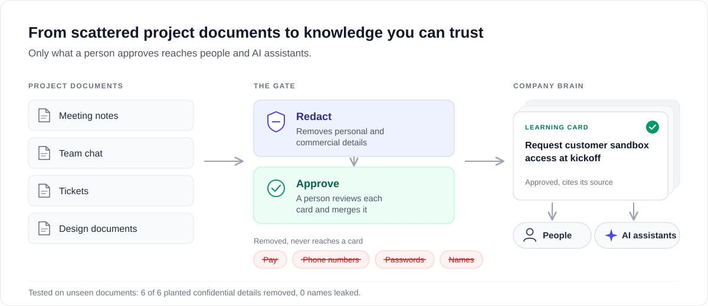

# Company Brain POC

Designed, built, and tested by **[Abhishek Katta](https://abhishekkatta.netlify.app)** with Claude Code and n8n.

A company brain captures each team's learnings and shares them with the rest of the company, after a person approves them. People and AI assistants can then ask it questions.

*Figure 1. Only content that a person approves reaches people and AI assistants. Redaction removes confidential details before a person reviews the cards.*

For example, a team's meeting notes record that a test run of a new billing system found errors before go-live. That lesson becomes a short learning card that any AI assistant can quote. A colleague's pay, mentioned in the same folder, never reaches a card.

**Tested on project documents it had never seen, with its rules locked:**

| 6 of 6 | 0 | 7 of 7 |
|:---:|:---:|:---:|
| Fabricated confidential details removed | Names leaked | Judgement tests passed, marked by a person |

For more information, see [Results](#results).

## Overview

Project knowledge sits in meeting notes, chat, tickets, and design documents. Nobody reads all of it, and nobody wants the personal or commercial details in it spread around the company.

This proof of concept (POC) reads one project's documents and writes three things:

- **A project brief:** One page with the current status, decisions, risks, conflicts between documents, and facts that later documents replaced. Each fact links to its source.
- **Learning cards:** Short lessons another team can reuse. For example, ask the customer for access to their test system during project kickoff.
- **A relation ledger:** One typed entry for each item that two documents state differently: a contradiction, a replaced fact, or a difference in scope. See [`relations.json`](relations.json).

Three scripts then check the output against the documents, with no model. See [Checks](#checks).

It runs in two modes:

1. A Claude Code job (`/capture`) that proposes new cards and a fresh brief. In this POC, I start it by hand. At scale, it runs on a schedule.
2. Four automated n8n workflows (see [Operated with n8n](#operated-with-n8n)), plus a feedback loop that turns questions and ratings into eval cases (see [Feedback loop](#feedback-loop)).

## Use cases

*Figure 2. Four ways that people and AI assistants use the company brain.*

## Why I built this

- **One GenAI setup:** To see how one Claude setup could serve both a project team and the whole company: shared context for the team, and a knowledge base anyone can ask questions.
- **Summarise once, read many:** Reading every document for every question is slow and expensive. The brain reads only what changed, uses a small, cheap model to pull out the facts, and answers from the brief first.
- **Eval set for trust:** I built evidence by hiding the failures a real company fears most in the test documents, such as leaked personal data, made-up facts, and conflicts settled without anyone noticing. I then scored each iteration.

## How it works

*Figure 3. The five steps of the capture job, and the two feedback loops that improve it. Nothing reaches step 5 without a person at step 4.*

The capture job opens a pull request (PR) on GitHub to propose new cards and a fresh brief. A person approves them by merging the PR. The prototype uses simple stand-ins for company systems, such as a Google Drive folder for the project file share. For every stand-in, see [Prototype vs at scale](#prototype-vs-at-scale).

### Key design choices

| Choice | How it works | Where to look |
|---|---|---|
| **Rules in files instead of prompts** | Files hold the card format, the 7 redaction rules (what to remove), the conflict rule, and the capture steps. | [`CLAUDE.md`](CLAUDE.md), [`card-extractor.md`](.claude/agents/card-extractor.md) |
| **Small model, narrow job** | Claude Haiku, a small and cheap model, pulls out the facts. It reads only what changed since the last run. A small update costs about 20% less than a full rebuild (93,000 against 115,000 tokens). | [`log.md`](log.md) records where the last run stopped |
| **Two layers of redaction** | Claude follows the redaction rules, then a pattern check catches what it missed. | [`redaction_check.py`](scripts/redaction_check.py) |
| **Show conflicts, do not resolve them** | When two documents disagree and neither replaces the other, the brief lists both under "Open conflicts". A later document replaces an earlier fact only with evidence: it gives the old value, it uses a change word such as "moved to", or it names the document it replaces. "Agreed" alone is not evidence. | [`brief.md`](brief.md), [`relations.json`](relations.json) |
| **Check every fact against its source** | A script traces each number, date, version, and identifier in a card or the brief to a document that the card or line cites. A fact that no cited document holds fails. | [`provenance_check.py`](scripts/provenance_check.py) |
| **Check before a person reviews** | The capture job runs the checks on its own output and fixes what fails, before it opens the pull request. | [`card-extractor.md`](.claude/agents/card-extractor.md), step 9 |
| **Approval is a merge** | The `main` branch, the approved version, never holds an unapproved card. | [`learnings/approved/`](learnings/approved/) |

## Operated with n8n

n8n is a workflow automation tool. The same capture and question-answering steps also run as four n8n workflows, with no Claude Code session. See [`n8n/`](n8n/) for the workflow exports and an import guide.

![Four n8n workflows. W1 Capture checks the Drive folder every minute. Claude Haiku writes one card, a redaction check tests it, and a clean card opens a pull request; otherwise W1 holds the document and writes no card. A person merges the pull request into the main branch. W3 Ask the brain is an MCP server with a Bearer token: search_approved_cards runs W3a Card search, and get_brief returns brief.md, both from the main branch only. W2 Error alerts emails the failed step, the error, and a link to the run if W1, W3, or W3a fails.](assets/n8n-workflows.svg)

*Figure 4. The four n8n workflows. W1 opens pull requests, W3 and W3a read only the `main` branch, and W2 sends an email when a workflow fails.*

Show what each workflow does

- **W1 Capture:** When a new Google Doc appears in the project folder, n8n sends it to Claude Haiku with the redaction rules, then runs the same pattern check. A clean card opens a pull request. If Claude cannot write the lesson without confidential details, W1 holds the document and writes no card.
- **W2 Error alerts:** If W1, W3, or W3a fails during a real run, n8n emails the failed step, the error, and a link to the failed run.
- **W3 Ask the brain:** An MCP server with two tools, `search_approved_cards` and `get_brief`, protected by a secret access key (a Bearer token). Both tools read only the `main` branch, so an assistant sees only approved cards.
- **W3a Card search:** The keyword search behind `search_approved_cards`. It returns up to 3 cards with their IDs, or "No approved learning covers this."

> [!NOTE]
> - MCP (Model Context Protocol) is the standard way AI assistants connect to outside tools.
> - W1 only writes cards. The Claude Code job still rebuilds the brief.

### What I tested in n8n

*Figure 5. The three live tests in n8n and their results.*

The four capture fixes run from a blocked Drive credential to a reply-parsing bug. See [Live fixes](n8n/README.md#live-fixes).

Show the W1 capture workflow in n8n

*Figure 6. W1 in the n8n editor, from the Drive trigger to the pull request or the held document.*

## Feedback loop

The brain learns from use: questions, ratings, and a regression eval set flow back to a person, who approves every change.

Show how the feedback loop works

| Part | What it does | Workflow |
|---|---|---|
| **Production log** | Writes each question to an n8n Data Table after the W1 redaction check, with the card IDs returned and "hit" or "coverage gap". | W3a Card search (logged) |
| **User ratings** | A third MCP tool, `rate_answer`, records "helpful", "wrong", "stale", or "missing" for an answer, after redaction. | W3b Rate answer |
| **Human review** | Every Monday, W4 counts the coverage gaps and poor ratings, and opens a pull request that proposes eval cases in `tests/answers/feedback_cases.json`. Merging the PR approves the cases. W4 never writes to `main`. | W4 Feedback review |
| **Regression eval set** | W4b reruns every approved case through the logged search and records pass or fail. Its first run is the baseline. | W4b Regression eval |

A question that held personal data, such as "When was the engineer on sick leave?", becomes a guardrail case: it must stay refused.

> [!NOTE]
> This is the outer feedback loop: signals from use become eval cases, and a person approves each change. It is not in-run feedback (the evaluator-optimizer pattern, where one model call critiques another within a single run). The Claude Code capture job has an in-run step of a different kind: scripts, not a second model call, check its output, and it fixes what fails. See [Checks](#checks). The n8n workflows do not have that step.

**Tested on 2026-11-10 with fictional test questions:**

- 5 questions wrote 5 log rows, each with the correct hit or coverage-gap flag.
- A planted phone number was stored as `[redacted:phone]`.
- One rating wrote one row.
- W4 opened [PR #26](https://github.com/eraserhead21/company-brain-poc/pull/26) with 3 proposed cases, and `main` stayed unchanged.

The workflow sources are in [`n8n/sdk/`](n8n/sdk/).

## Prototype vs at scale

The approval step stays the same at any scale: an AI assistant reads only what a person approved. What changes is how documents come in, how the system catches confidential details, and how people find cards. The table also lists the stand-in that the prototype uses for each company system.

Show all 10 parts and how each one changes at scale

| Step | In this prototype | At scale |
|---|---|---|
| Sources | Stand-ins: a Google Drive folder for the project file share (copies in [`sources/`](sources/)), a Drive document holding a chat log for team chat, GitHub Issues on this repo for the issue tracker, and this repo ([`src/`](src/), [`docs/`](docs/), [`decisions/`](decisions/)) for team code and design records. n8n checks the Drive folder every minute. It picks up new documents only, not edits. | Drive, SharePoint, and Slack notify the system as soon as something changes. The system captures an edited document again. |
| Redaction | Rules in the instructions to Claude, then a pattern check. Claude sees the original text. | A dedicated tool for finding personal and sensitive data (such as Google Sensitive Data Protection, Microsoft Purview, or Presidio) removes it before Claude sees the text. The rules and the pattern check stay as extra layers. The AI provider agrees not to store the data. |
| Extraction | One card per document, from the first 60,000 characters. | The system splits long documents into parts, writes several cards per document, and checks every card against a fixed format. It compares each new card with existing cards to avoid duplicates. The test set runs again whenever the instructions change. |
| Held documents | The workflow stops and tells nobody. | A review list records why W1 held the document and tells its owner. |
| Approval | One person merges a pull request on GitHub. | The same merge, with a named owner for each topic. Reviewers who do not use GitHub approve in Slack or email, through n8n's built-in approval step. |
| Search | Stand-ins: [`learnings/approved/`](learnings/approved/) for the company knowledge base. For company search, a claude.ai Project (a Claude workspace limited to chosen files) that knows only the approved cards, or any AI assistant connected through W3. Simple keyword matching. Each question reads every card from GitHub. | The system indexes cards when a person approves them, so search can match meaning as well as keywords ("leave" also finds "absence"). Answers still cite card IDs. |
| Freshness | Cards never expire. The check for out-of-date claims (`/lint-wiki`) runs only when someone starts it. | Each card has an owner and a review date. The check runs on a schedule, and a newer card retires the one it replaces. |
| Access | One shared access key. Everyone with the key sees every approved card. | Each person signs in and sees only the cards their role allows, using each card's `sensitivity` field. |
| Operations | An email when a workflow fails. One n8n trial account. | Automatic retries, alerts in Slack or to the on-call person, extra capacity for busy periods, separate test and live setups, and keys in a secure vault. |
| Coverage and audit | W3a (logged) writes each question, redacted, to an n8n Data Table with "hit" or "coverage gap". W4 reviews the gaps and ratings weekly and proposes eval cases in a PR. | The system logs every question with who asked and which cards answered. It counts each "No approved learning covers this", which shows what the brain is missing. |

For what this prototype does not prove, see [Known gaps](#known-gaps).

## How I tested it

I planted the failures a company fears most in a fictional project, then scored each round against an answer key.

Show the test project and how it is scored

> [!NOTE]
> All project data in this repo is fictional. I fabricated the names, contact details, passwords, and commercial terms.

"Project Alpha" is the test project: a utility company moving its smart-meter readings to a new real-time billing system. Its documents contain what the capture job must handle:

- **Redaction:** 11 people's names, and 20 fabricated confidential details (phone number, home address, health, pay, performance, date of birth, passwords, access tokens, customer account, contract value, profit margin, talk of switching suppliers, and an invoice dispute).
- **Judgement:** 3 conflicts between documents, 1 fact that a later document replaced, and 8 lessons a careful reader would find.
- **Answer key:** [`tests/answers/`](tests/answers/). The rules tell the capture job never to read `tests/`.
- **Unseen test set:** 2 more Drive documents and 1 issue with new kinds of hidden details, an answer key that I wrote before any run saw them, and one trap (the same date written two ways).
- **Second unseen test set (round 5):** 3 more documents, with the key written first. The hidden details avoid the pattern check on purpose: pay written in words, a health note with no keyword, a name written as an initial and a surname. The 7 judgement tests include a decision with no mention of the old value, a decision that gives the old value, a record that names the document it replaces, an old document that turns up late, and one date written two ways.
- **Third unseen test set (round 6):** 2 more documents, with the key written first. Each of 2 new conflicts is against a value that the brief already gave as a decision. The 8 judgement tests also include a conflict that a later document resolves, and the same number about another item.

[`tests/score.py`](tests/score.py) checks redaction and names automatically, and lists the judgement tests for a person to mark. With `--auto`, a script marks them as well. [`tests/results/`](tests/results/) holds each round's marks and scores.

## Checks

Three scripts test the output against the documents. They use no model and no network, and capture runs them before it opens a pull request.

| Check | What fails | Script |
|---|---|---|
| **Redaction** | A pattern for a confidential detail: a phone number, a password, a pay amount. | [`redaction_check.py`](scripts/redaction_check.py) |
| **Provenance** | A number, date, version, or identifier that is in no document the card or line cites. A citation that does not resolve, or that points outside the source folders. | [`provenance_check.py`](scripts/provenance_check.py) |
| **Relations** | A "replaced" fact with no evidence in the later document. A later document dated before the earlier one. A conflict in the ledger that the brief does not list. A brief line outside Open conflicts that gives one side of an open conflict as a fact. | [`relations_check.py`](scripts/relations_check.py) |

Show how the checks were tested

- **Known-bad cases from round 1.** Round 1 made up 4 facts. Their text, from git history, is now a test. The provenance check fails 3 of the 4. The 4th is a made-up reason with no number: the check lists it for a person and does not fail it.
- **Planted errors.** A test changes one number, date, or version in each card line and swaps each card's sources. The check catches 80 of 87. In the 7 it misses, the wrong value is also in a cited document.
- **The missed conflict, first.** Before any rule changed, a test showed that the round 4 output fails: "retention 90 days moved to 30 days" has no evidence of a change.
- **Red-team cases.** Each check has cases written to break it. The cases that held are tests. The cases that broke a check are also tests, named as known gaps.
- **Script marks against a person's marks.** The script agrees with all 55 marks that a person saved in rounds 1 to 4. The first set of rules agreed with 54. On the second unseen set the script agrees with 6 of the 7 marks: it passed one test that the person failed.
- **A defect that a person found, first.** In round 5 the brief listed a limit as an open conflict (5k against 4k) and still gave 5k under Decisions. A test on that brief came before the check. The check now fails that brief and names the line. It also fails two older outputs with the same defect.

One command runs everything: `python scripts/run_checks.py`. For the full record, see [round 5](iterations/05-provenance-and-relations.md) and [round 6](iterations/06-contested-values.md).

## Results

Redaction held in all 6 rounds with 0 names leaked. Judgement tests rose from 8/12 to 12/12 on the main set. On unseen documents they passed 7/7 in round 4 and 4/7 in round 5. In round 6 a script marked 8/8, against 5/8 for the round 5 rules on the same documents; no person has marked that round.

Show the scores for each round

| Round | Change | Redaction | Names leaked | Judgement tests |
|---|---|---|---|---|
| 1 | First version | 20/20 | 0 | 8/12 |
| 2 | New rules for conflicts and lessons | 20/20 | 0 | 11/12 |
| 3 | Clearer wording for conflicts, after reviewer feedback | 20/20 | 0 | 11/12, less clutter |
| 4 | **Unseen documents (a held-out set), rules locked** | **6/6** | **0** | **7/7** |
| 5 | Typed relations, provenance check, checks inside capture | 20/20 | 0 | 12/12, marked by a script |
| 5 | **Second set of unseen documents, rules locked** | **8/8** | **0** | **4/7** (a script marked 5/7) |
| 6 | **Third set of unseen documents, rules locked:** a contested value is never a settled fact | **4/4** | **0** | **8/8**, marked by a script. The round 5 rules scored 5/8 on the same documents |

A person marked rounds 1 to 4 and the second unseen set. A script marked the round 5 rebuild and round 6.

New checks in round 5, on the same output before and after:

| Check | Round 4 output | Round 5 output |
|---|---|---|
| Facts that no cited document holds | 3 in 109 checked | 0 in 102 checked |
| Relations that fail against the documents | No ledger | 0 in 10 |
| The missed conflict (C1) | Recorded as a replaced fact | Listed as an open conflict |

Each round has a page in [`iterations/`](iterations/) with its failures, the exact rule change, the score after, and the cost. Round 3 is the clearest example: a reviewer said the list of conflicts was unclear, and the page shows the list before and after the rule change. Round 5 shows the two tests that the second unseen set failed. Round 6 shows a defect that a person found, the test that reproduced it, and a control run.

## Known gaps

The biggest gap: the newest unseen test passed 4 of 7 judgement tests, and the checks did not see the three misses.

Show what round 5 closed

- **The missed conflict (C1) is fixed.** A meeting note says "Agreed: retention is 30 days"; the design document says 90. The brief now lists both under Open conflicts. "Agreed" alone no longer replaces a fact.
- **Made-up facts now have a test, in part.** The provenance check fails 3 of the 4 facts that round 1 made up. See the first gap below for what it misses.
- **A script now marks the judgement tests, in part.** It agrees with all 55 marks that a person saved in rounds 1 to 4, and with 6 of 7 on the second unseen set. See the gaps below for its limits.
- **Replaced facts keep their history.** [`relations.json`](relations.json) holds every relation and has no word limit. The brief still trims other facts to fit 600 words.

Show what round 6 closed

- **The brief no longer gives a contested value as a decision.** In round 5 the brief listed a limit under Open conflicts (5k against 4k) and still gave 5k under Decisions. A person found it while marking. A rule and a check now cover it: the line reads "contested, see Open conflicts". On 2 unseen documents the new rules kept 3 contested values out of Decisions. The round 5 rules left 2 of them in. See [round 6](iterations/06-contested-values.md).

Show all 19 open gaps

- **The provenance check reads words, not meaning.** It misses a claim that reverses its source ("No duplicates" to "Duplicates were seen"), a wrong number that the source also holds, and a made-up reason with no number in it. It lists unknown words for a person. Only a model or a person can judge meaning.
- **Three misses on the second unseen set.** An old review note says the partition count "moved to 24"; a later decision record says 12. Capture kept 12, which is correct, but did not list the conflict. It did not record that an alert limit for a test run and the limit for go-live are two scopes. It wrote "9 days" for a test run that was 7 days, and did not record that 9 replaced 7. For the cause that capture reported, see [round 5](iterations/05-provenance-and-relations.md#what-failed).
- **The contested-value check reads the brief, not the cards.** A card can still give one side of an open conflict as the decision. The control run in round 6 wrote such a card. The check is a keyword test: it wrongly fails the same number about another item from the same document, and it misses a claim with no number that is put in other words.
- **Round 6 has one run for each set of rules, and no person has marked it.** The 8/8 against 5/8 is two runs of a model, marked by a script. The check found nothing to fix inside the capture run, so the rule did the work.
- **The brief is over its length limit.** After round 6 it is 752 words against a limit of 600. Each open conflict adds a quoted line. No script checks the length. One contested line also lost a detail that no document disputes.
- **The checks cannot find what capture left out.** They test each relation that capture wrote. All three reported 0 failures on the run that missed three relations.
- **No run has written a scope difference.** Only unit tests cover that type.
- **The script is more lenient than a person.** On the second unseen set the script passed 5 of 7 and a person passed 4. The script took a card and a date line as the record of a replaced fact. A script marked the round 5 rebuild (12/12), and no person has. The script uses keyword rules, written with the earlier human marks in view.
- **Same person, same test.** I tuned rounds 2, 3, and 5 on the test I scored them on. I also wrote both unseen sets, their keys, and the rules.
- **Nothing enforces the wall around the tests.** The rules tell capture not to open the answer keys, the iteration pages, this README, or old log lines. Capture reports the files it opened. No permission blocks it.
- **Redaction covers the knowledge base, not the original documents.** A Project that read the Drive documents directly gave out a team member's leave dates. The original documents need their own access controls.
- **The pattern check misses paraphrases.** It does not catch pay written in words, a health note with no keyword, a token with no colon, a supplier switch in other words, or an account number with no prefix. Claude caught all 8 such details in round 5. The pattern check is then no second layer.
- **A full rebuild renames cards.** 3 of the 13 card IDs survived the round 5 rebuild. An eval case that names a card ID can break.
- **The n8n workflows do not run the new checks.** W1 writes one card and no ledger, and it cites a document by its Drive title. The provenance check can read that citation only when the document has an export in `sources/`. A second W1 run on the same document opened a second pull request for the same card (#16 and #27).
- **A failed check does not block a merge.** The checks run on GitHub for each pull request and each push to `main` ([`checks.yml`](.github/workflows/checks.yml), first run on 2026-11-13). No branch rule requires a pass, so a person can still merge a pull request that fails.
- **No card owner or review date.** Cards never expire. The provenance check flags a card when its source changes and the fact is gone, but only when someone runs it.
- **Cost.** A full rebuild took about 59,000 Haiku tokens in round 1 and 123,500 in round 5. A small update took 95,500. The cost test in [`tests/eval_questions.md`](tests/eval_questions.md), which compares answering from the brief with answering from the original documents, has not run.
- **The feedback loop is new.** It went live on 2026-11-10 and has run only on fictional test questions. W4b has no baseline until a person merges the first feedback PR. Repeated W4 runs and one-sided ratings are not tested.
- **One-person simulation.** No real user roles, single sign-on, permission-aware search, Microsoft 365, or ticketing system. The stand-ins show the shape of the solution, not how it behaves at scale.

## Repo map

Show what each file and folder holds

| Path | Description |
|---|---|
| [`CLAUDE.md`](CLAUDE.md) | The rules: card format, what to remove, and how to handle conflicts |
| [`brief.md`](brief.md) | The current project brief |
| [`relations.json`](relations.json) | The relation ledger: every contradiction, replaced fact, and scope difference, with its sources |
| [`learnings/approved/`](learnings/approved/) | Approved learning cards |
| [`sources/`](sources/) | Copies of the Drive documents (fictional, with planted details), and snapshots of the GitHub issues that cards cite in [`sources/github/`](sources/github/) |
| [`src/`](src/), [`docs/`](docs/), [`decisions/`](decisions/) | The stand-in team repo: code, architecture notes, and architecture decision records (ADRs) |
| [`iterations/`](iterations/) | One page per improvement round |
| [`tests/`](tests/) | Answer keys, the scoring script, and saved results |
| [`scripts/`](scripts/) | The three checks (redaction, provenance, relations), one command that runs every check, and the scripts that stage sources and save GitHub issues |
| [`.github/workflows/checks.yml`](.github/workflows/checks.yml) | The GitHub Actions workflow that runs the checks on every pull request and every push to `main` |
| [`.claude/`](.claude/) | The Claude Code commands for capture and checking, and the small-model helpers they use |
| [`project-instructions/`](project-instructions/) | Instructions for the two claude.ai Projects |
| [`log.md`](log.md) | A log of every run: counts, cost, and where the last run stopped |
| [`n8n/`](n8n/) | Exports of the four core n8n workflows, the feedback-loop workflow sources in [`n8n/sdk/`](n8n/sdk/), and an import guide |
| [`assets/`](assets/) | The diagrams and the n8n screenshot in this README |
| [`CONTRIBUTING.md`](CONTRIBUTING.md) | How to run, review, and extend the POC |
| [`poc-config.json`](poc-config.json) | The Drive folder ID, and which Drive document matches which file in `sources/` |

## Run it

You need Claude Code, the GitHub CLI, Python 3, and the Google Drive connector, plus your own Drive folder. Set its ID in [`poc-config.json`](poc-config.json). With no Drive folder, capture can read the copies in [`sources/`](sources/) instead: see staged mode in the [capture steps](.claude/skills/capture/SKILL.md). The checks need only Python.

> [!WARNING]
> Capture sends document text to the Anthropic API before redaction. Use test data only.

Show the steps to run capture with Claude Code

1. Run `/capture` in Claude Code in this folder. It opens a pull request with new cards and a fresh brief.
2. Review the pull request. Merge it to approve, or close it to reject.
3. Run `python scripts/run_checks.py`. It runs the unit tests, the three checks, and each answer key with script marks. To mark the judgement tests yourself, run `python tests/score.py` and add `--save <run>` to keep the record.
4. Run `/lint-wiki`. It writes [`lint-report.md`](lint-report.md): conflicts, out-of-date claims, unlinked cards, duplicates, and facts that no source holds.
5. Optional: create the claude.ai Projects "Alpha" and "Ask the Org" from [`project-instructions/`](project-instructions/) to ask questions over the brief and the cards.

To run capture and questions on n8n instead, import the workflows in [`n8n/`](n8n/). For more information, see [`n8n/README.md`](n8n/README.md).
